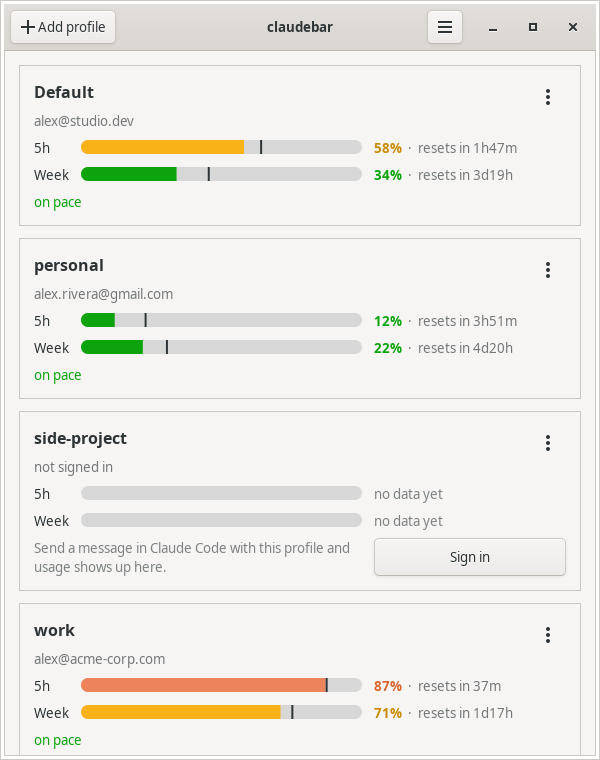
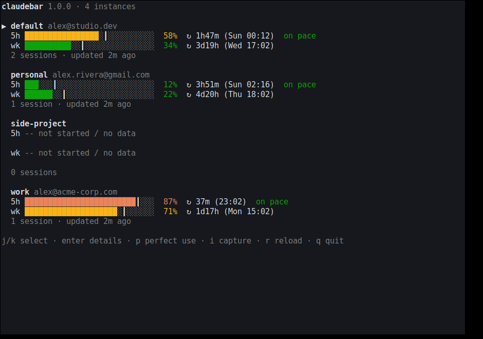

# claudebar

A usage meter for Claude Code, written in C. Shows your 5-hour and weekly limits,
resets, pace and projections for **every Claude config on the machine**: the
default `~/.claude` and each [mcl](https://github.com/mkalmousli/mcl) instance.

- **Instant**: the status-line hook is one small file write; the view reads a few files.
- **Multiple instances**: each is tracked, installed and controlled on its own.
- **Stable**: no dependencies beyond a C compiler and libc; no locks (one file per session).
- **Your status line is kept**: it is chained, and `uninstall` restores it byte for byte.
  For mcl, claudebar chains mcl's own status line.

## Install

```sh
curl -fsSL https://raw.githubusercontent.com/mkalmousli/ClaudeStatusBar/main/install.sh | sh
```

Downloads the prebuilt, checksum-verified binary for your machine (falls back to a source
build), then runs `claudebar install`: copies itself to `~/.local/bin`, hooks every Claude
instance, and starts a user service (systemd / launchd). No root. Capture is automatic:
new instances are hooked on their own. `claudebar uninstall` undoes everything and
restores your status line exactly (and stays off until you install again).

Prebuilt for Linux (x86_64, aarch64, armv7, i686, riscv64, ppc64le, s390x), macOS
(Intel, Apple silicon) and FreeBSD (x86_64, aarch64). Windows: use WSL.

**Updates** are automatic (the service checks daily and swaps in the verified release
binary). `claudebar update` does it now; `claudebar set autoupdate off` stops it;
`claudebar update --source` builds from git instead. From a checkout:
`cc build.c -o build && ./build install`.

## GUI





(Demo data.)

`claudebar gui` (or the "claudebar" menu entry; it autostarts hidden in the tray) shows one
card per **profile**: its name, signed-in account, the 5h and weekly meters (the line marks
how much of the window has passed), and whether you are on pace. Everything is in the window:

- **Add profile** (header): a name, optionally sharing settings with Default; it then opens a
  terminal so you can sign in. Uses [mcl](https://github.com/mkalmousli/mcl) when installed.
- **Card menu (⋮)**: start a session now, start sessions automatically (Perfect Use),
  remove the profile. **Sign in** appears on profiles with no account yet.
- **Header menu**: update automatically, check for updates, quit.

The tray icon is a ring filled to your 5h usage; panels that show a label print
`5h 42% · wk 18%`. It works through StatusNotifier (KDE, Xfce 4.16+, GNOME with the
AppIndicator extension, Cinnamon, MATE, LXQt, Budgie, sway/waybar) via
`libayatana-appindicator` when installed, else the classic XEmbed tray; with no tray the
window is a normal window. Command-driven panels (xfce4-genmon, polybar, waybar, tmux) can use
`claudebar status --line`. The same actions exist on the CLI: `claudebar add|remove|run NAME`.

The GUI is a separate optional binary (GTK3, Linux/BSD): `./build` makes it when
`libgtk-3-dev` is present; the installer and `claudebar update` fetch the prebuilt one
(Linux x86_64, aarch64) when GTK3 is installed.

## Use

```
claudebar gui                     window + tray icon
claudebar                         interactive terminal view (j/k, enter = sessions, p, i, +/-, s)
claudebar status [-i NAME]        print usage; --line for tmux/polybar/waybar
claudebar set perfect on [-i N]   Perfect Use: start each free 5h window, warn before waste
claudebar set cost 17 [-i N]      weekly % one 5h session costs (0 = measured)
claudebar start -i NAME           start a 5h session now
claudebar daemon                  run Perfect Use headless (systemd user unit, cron @reboot)
claudebar set autoupdate off      stop the daily self-update
claudebar uninstall               remove binary, service and hooks (data is kept)
```

Data lives in `~/.local/share/claudebar` (`CLAUDEBAR_HOME` overrides). Linux, macOS, BSD.

## Develop

`./build` (incremental, parallel), `./build test`, `./build clean`. Env: `CC`, `CFLAGS`, `OUT`. Releases: push a tag `v*`; the workflow
cross-builds every target with `zig cc` and publishes them. Every source file is
at most 100 lines.
